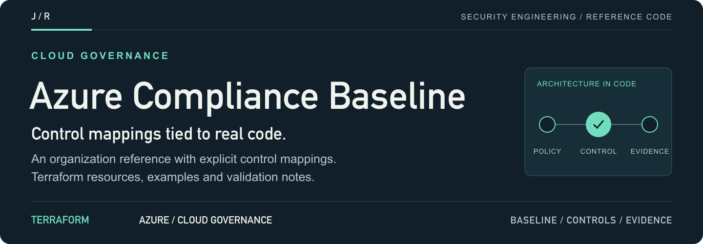
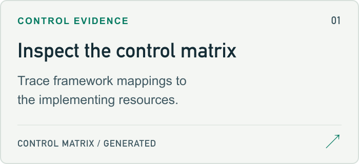
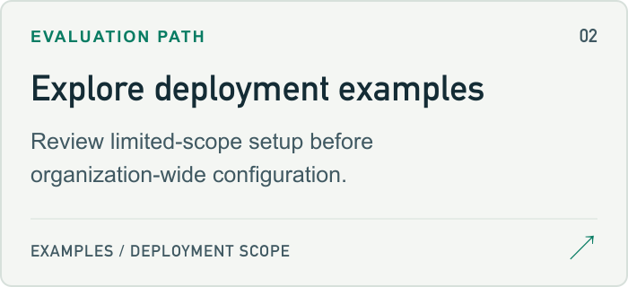
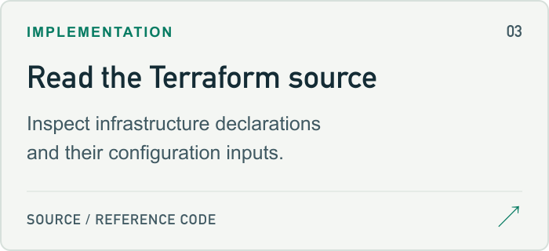
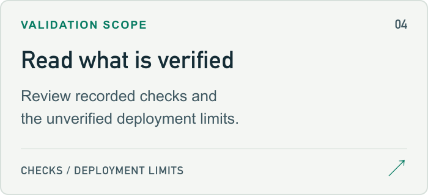

<a id="az-compliance-baseline-terraform"></a>

<a href="examples/single-subscription/README.md">
<picture>
  <source media="(max-width: 600px)" srcset="docs/assets/readme/header-mobile.png">
  
</picture>
</a>

<p>
  <a href="examples/single-subscription/README.md"><strong>Start here ↗</strong></a> &nbsp; / &nbsp;
  <a href="terraform/main.tf">Source</a> &nbsp; / &nbsp;
  <a href="#project-guide">Project guide</a> &nbsp; / &nbsp;
  <a href="https://github.com/jmragsdale">Profile</a>
</p>

A Azure governance reference with Terraform implementations, framework mappings, deployment examples and documented validation limits.

## Explore the project

Open a card for source, examples or supporting documentation.

<p>
<a href="CONTROLS.md">
<picture>
  <source media="(prefers-color-scheme: dark)" srcset="docs/assets/readme/controls-dark.png">
  
</picture>
</a>
<a href="examples/single-subscription/README.md">
<picture>
  <source media="(prefers-color-scheme: dark)" srcset="docs/assets/readme/examples-dark.png">
  
</picture>
</a>
<a href="terraform/main.tf">
<picture>
  <source media="(prefers-color-scheme: dark)" srcset="docs/assets/readme/source-dark.png">
  
</picture>
</a>
<a href="#validation-scope">
<picture>
  <source media="(prefers-color-scheme: dark)" srcset="docs/assets/readme/limits-dark.png">
  
</picture>
</a>
</p>

## Project guide

Terraform that brings an Azure tenant into alignment with FedRAMP Rev 5, NIST SP 800-53 Rev 5 and CIS Microsoft Azure Foundations v3.0.0 — and a CI job that fails the build the moment a compliance claim stops matching the code behind it.

---

## 🎯 Overview

Most "compliance baseline" repos claim framework coverage in a README table that
nothing verifies. The table drifts from the code within a release or two and
there is no signal when it does.

Here the claim and the code cannot separate silently. `controls/controls.yaml`
is the single source of truth: every control names the Terraform address that
implements it, `CONTROLS.md` is generated from it, and CI fails if any address
stops existing or if the generated file drifts. **74 controls, 100% of them
backed by a resource that provably exists.**

The other half of the design is honesty about what a Terraform module can and
cannot do. FedRAMP is an authorization process, not a module you `apply`. This
repo implements the *technical* controls, states plainly which ones need
privileges you may not have, and refuses to hard-code a policy GUID it has not
verified — because a green dashboard against the wrong benchmark version is
worse than no dashboard.

<details>
<summary>Architecture flow (text)</summary>

```
┌─────────────────────────────┐   ┌──────────────────────────────┐   ┌─────────────────────────────┐
│  MANAGEMENT GROUPS          │   │  AZURE POLICY                │   │  DEFENDER FOR CLOUD         │
│  AC-3 · CM-2 · SC-7         │   │  preventive + evaluative     │   │  detective  (all metered)   │
│                             │   │  CA-2 · CA-7 · CM-6 · CM-7   │   │  RA-5 · SI-3/4/7 · IR-6     │
│  Tenant Root  (never        │   │                              │   │                             │
│   │            written)     │   │  FedRAMP Moderate ─OR─ High   │   │  Servers P1(mod)/P2(high)   │
│   └── mg-root  ◄── policy   │   │  NIST 800-53 Rev 5            │   │  Storage · SQL · Containers │
│        ├── platform  scope  │   │  Microsoft Cloud Sec Bmk      │   │  Key Vault · ARM · AppSvc   │
│        ├── landing-zones    │   │  CIS v3.0.0  ⚠ GUID unverified│   │  Open-source relational DB  │
│        │    ├── prod        │   │                              │   │                             │
│        │    └── nonprod     │   │  6 custom DENY guardrails:   │   │  security contacts (IR-6)   │
│        ├── sandbox (out of  │   │   regions · VM SKUs · tags   │   │  continuous export          │
│        │    boundary)       │   │   min-TLS · public blob      │   │  custom WORM-lock assessment│
│        └── decommissioned   │   │   public IP on NIC           │   │                             │
│                             │   │                              │   │                             │
│  skipped entirely when      │   │  DINE diagnostics initiative │   │                             │
│  deployment_scope =         │   │  1 remediation identity,     │   │                             │
│  "single_subscription"      │   │  scoped — never tenant root  │   │                             │
└─────────────────────────────┘   └───────────────┬──────────────┘   └──────────────┬──────────────┘
                                                  │                                  │
        ┌─────────────────────────────────────────▼──────────────────────────────────▼─────────────┐
        │  AUDIT RECORD FLOW —  AU-2 · AU-6 · AU-9 · AU-11 · AU-12                                  │
        │                                                                                           │
        │   resources ──► diagnostic settings ──► Log Analytics ──► immutable WORM archive          │
        │   + Activity   (attached by DINE,      (365d moderate     (1095d GRS  /  2555d RAGRS)     │
        │     Log         never by hand)          730d high)         created UNLOCKED — see below   │
        │                                              │                        ▲                   │
        │                                              └──► Event Hub ──► SIEM  │ CMK from Key Vault│
        │                                                   AU-9(2)             │ RSA-HSM 3072/4096 │
        │                                                                       │ rotate P365D/P180D│
        │   Activity Log alerts: policy assignment write/delete · NSG + rule write · Key Vault       │
        │   delete · Defender pricing change · role assignment write · diagnostic setting delete     │
        └───────────────────────────────────────────────────────────────────────────────────────────┘
```

</details>

Full-resolution diagram: [`az-compliance-baseline.svg`](az-compliance-baseline.svg)

---

## ✨ Features

- 🔐 **74 controls, all falsifiable.** Every entry in `controls/controls.yaml` names a real Terraform address. `python3 controls/render.py --check` fails the build on a dangling reference or a stale `CONTROLS.md`.
- 🎚️ **`fedramp_baseline` actually changes behaviour.** Not a label. It selects which built-in initiative is assigned, and drives workspace retention, WORM window, storage replication, CMK size and rotation cadence, disk encryption type and the Defender for Servers plan tier — all from one lookup map in `locals.tf`.
- 🏢 **Runs with or without the tenant root.** `deployment_scope = "single_subscription"` gates off every `Microsoft.Management` resource and reassigns the identical policy set one level down, so the repo plans cleanly for someone who does not own the org.
- 🚫 **Six hard denials the built-in initiatives only audit.** Approved regions, approved VM SKUs, required inventory tags, storage TLS floor, anonymous blob access, NIC-attached public IPs — each parameterised so you can stage `Audit → Deny`.
- 🧾 **An exemption process, not a hole.** Exemptions require a justification and an expiry by schema. Azure stops honouring them at the expiry date, so an unrenewed waiver fails closed.
- 🔒 **WORM audit archive with customer-managed keys.** Time-based immutability, blob versioning, change feed, geo-redundancy, shared-key auth disabled, one-hour SAS ceiling.
- 🛰️ **Diagnostic settings deployed by policy.** A DINE initiative attaches them across five resource types and reports every resource it has not reached — which is the AU-12 evidence.
- 💸 **Every metered service defaults to `false`.** All nine Defender plans, DDoS Network Protection, flow logs, private endpoints. The zero-cost posture is the default posture.
- 🧪 **Four independent scanners in CI.** `terraform fmt`/`validate`, tflint, Checkov, Trivy, Conftest with real Rego unit tests, gitleaks, plus the control-matrix integrity check.
- 📤 **Evidence export that admits what it could not read.** `scripts/export-evidence.sh` produces a timestamped JSON/CSV bundle and records failed sections in `manifest.json` instead of shipping a silently empty file.

---

## 🚀 Quick Start

```bash
git clone https://github.com/<you>/az-compliance-baseline-terraform
cd az-compliance-baseline-terraform

# 1. Confirm the repo is internally consistent before you trust any of it.
python3 controls/render.py --check
./scripts/validate.sh

# 2. Smallest useful shape: one subscription, Audit effects, zero metered services.
cd examples/single-subscription
terraform init
terraform plan
```

For the full posture — management group hierarchy, FedRAMP High, every Defender
plan — see [`examples/org-wide/`](examples/org-wide/). Read its README first;
it is not a cheap plan.

**Recommended rollout order against a live tenant:**

1. `guardrail_effect = "Audit"`, `policy_assignment_enforcement = "DoNotEnforce"`. Apply. Wait 24 hours for a full evaluation cycle.
2. Read the compliance dashboard. Everything red is something that *would have been blocked*.
3. File exemptions for the legitimate cases, with expiry dates.
4. Flip `guardrail_effect = "Deny"`.
5. Flip `deny_internet_egress = true` only after a firewall or private-endpoint egress path is verified.
6. Lock the archive immutability policy last. It is irreversible.

---

## 🔐 Controls

Generated matrix with per-control Terraform addresses, reverse index and caveats:
**[`CONTROLS.md`](CONTROLS.md)**

| Framework | Version | Controls implemented | Distinct framework IDs mapped |
|---|---|---:|---:|
| FedRAMP Rev 5 (Moderate / High) | Rev 5 | 73 / 74 | 46 |
| NIST SP 800-53 Rev 5 | Rev 5 | 74 / 74 | 76 |
| CIS Microsoft Azure Foundations Benchmark | v3.0.0 | 67 / 74 | 24 |

| Enforcement type | Count | Meaning |
|---|---:|---|
| preventive | 36 | blocks the non-compliant configuration from being created |
| detective | 24 | detects and reports it |
| foundational | 14 | provides the substrate the others depend on |

Control ID prefixes: `MG-` management groups · `POL-` policy · `IAM-` Azure RBAC ·
`LOG-` audit pipeline · `DET-` detection · `ENC-` cryptography · `NET-` network
boundary · `DAT-` data protection.

**These numbers count technical controls implemented in Terraform.** They are not
an assessment, not an ATO, and not a claim of full baseline coverage. FedRAMP and
NIST 800-53 include large administrative and procedural families — awareness and
training, personnel security, physical protection, most of planning and program
management — that no amount of Terraform will ever satisfy.

---

<a id="validation-scope"></a>

## ⚠️ What is and is not verified

Read this section before you believe anything above it.

**This repo is plan-verified. It has never been applied against a real tenant.**
There are no Azure credentials anywhere in this project and no `apply` has ever
run. CI does `terraform init -backend=false`, `terraform validate`, `tflint`,
Checkov, Trivy, Conftest and the control-matrix check. That catches syntax,
schema, type and policy-logic errors. It does not catch:

- an ARM API that rejects a valid-looking property combination
- a resource provider not registered in your tenant
- a role assignment that lands but does not grant what you expected
- a Defender sub-plan name that changed since this was written

**Controls that need privileges you may not have.** Everything with a `MG-`
prefix, plus MG-scoped policy assignments and MG-scoped role assignments,
requires:

- the `Microsoft.Management` resource provider registered in the tenant
- Owner, or Contributor **plus** User Access Administrator, at the parent
  management group — often the tenant root group, which is an elevated,
  audited action in Entra ID

If you do not have those, use `deployment_scope = "single_subscription"`. It is
not a degraded mode; it is a smaller scope with the same controls.

**Policy set definition GUIDs.** Built-in initiative GUIDs are stable, but they
differ between commercial and sovereign clouds and are not reliably
discoverable from documentation. This repo ships FedRAMP Moderate, FedRAMP High,
NIST 800-53 Rev 5 and the Microsoft Cloud Security Benchmark as verified, and
**deliberately ships no GUID for CIS Azure Foundations v3.0.0.** That initiative
is skipped, the `initiatives_requiring_guid_verification` output tells you it was
skipped, and you supply the real value via `builtin_initiative_id_overrides`
after confirming it:

```bash
az policy set-definition list \
  --query "[?contains(displayName,'CIS Microsoft Azure Foundations Benchmark v3')].name" -o tsv
```

Guessing would have been easy and would have produced a compliance dashboard
that looks green against the wrong control set.

**The WORM archive is created Unlocked.** Time-based immutability in `Unlocked`
state can still be shortened or removed by a subscription owner, and an assessor
will treat that as a finding. Locking is irreversible for the life of the storage
account — not even Microsoft can undo it — so a module that locks it during your
first apply has destroyed your ability to clean up a mistake. Locking is a
documented manual step, surfaced in the `post_apply_manual_steps` output.

**deployIfNotExists remediation needs Contributor.** Microsoft's own FedRAMP and
NIST initiatives contain remediation tasks that deploy agents and modify resource
properties. There is no least-privilege role that covers them. The mitigations
applied here are a dedicated non-interactive identity, role assignments scoped to
the baseline MG or subscription rather than tenant root, and Security Admin
granted separately so Defender configuration does not require Owner. If your
assessor will not accept that, run with `DoNotEnforce` and remediate through
change control instead.

**Terraform does not remediate pre-existing resources.** It creates the DINE
policies. Fixing resources that existed before the policy requires
`az policy remediation create`, which is an operational step, not an apply.

**Entra ID is out of scope, on purpose.** Conditional Access, PIM eligibility,
access reviews and authentication methods are a separate control plane with a
separate provider and a separate blast radius — a bad Conditional Access policy
locks every administrator out of the tenant. They live in the author's separate
**`az-iam-conditional-pim`** repo and are cross-referenced rather than
duplicated. The `IAM-` controls here cover Azure RBAC role assignments only.

**CIS section numbers are cited at section granularity.** Sub-numbering shifted
between CIS Azure Foundations v2.0.0 and v3.0.0. Citing a precise recommendation
number that has not been re-verified against the published v3.0.0 PDF would be
worse than citing the section, so `CONTROLS.md` cites sections and says so.

**FedRAMP is a process, not a Terraform module.** This repo produces technical
evidence for a subset of controls. It does not produce an SSP, a POA&M, a 3PAO
assessment, continuous monitoring deliverables, personnel screening records, or
an authorization. If someone tells you a Terraform module makes you FedRAMP
compliant, they have not been through an assessment.

---

## 💰 Cost

Everything metered defaults to `false`. The `examples/single-subscription`
posture costs roughly **USD 5–10/month**; `examples/org-wide` is four figures
before a single workload runs.

| Item | Default | Rough cost | Notes |
|---|---|---|---|
| Azure Policy evaluation | on | **free** | Assignments, definitions, compliance dashboard — all free |
| Management groups | on (MG scope) | **free** | |
| Activity Log alerts + action group | on | **free** | Alert rules on Activity Log carry no charge |
| Log Analytics ingestion | on | ~USD 2.30/GB | Usually the largest line item. Activity Log alone on a quiet subscription is cents/day |
| Log Analytics retention beyond 31 days | on | ~USD 0.10/GB/month | 730-day High retention on a busy estate adds up fast |
| Key Vault **Premium** (HSM) | on | ~USD 1/key/month + operations | 3 keys. FIPS 140-2 Level 3 |
| Archive storage (Cool → Archive tier) | on | pennies–dollars | Lifecycle tiering exists specifically to keep 7-year retention affordable |
| Private endpoints | **off** | ~USD 7.50/month each + data | 2 endpoints when enabled |
| NSG flow logs + traffic analytics | **off** | storage + ~USD 2.30/GB analytics | Traffic analytics is the expensive half |
| Defender for Servers P1 / P2 | **off** | ~USD 5 / ~USD 15 per server/month | P2 is what RA-5 and SI-7 actually want |
| Defender for Storage (V2) | **off** | ~USD 10/account/month + malware scan per GB | Malware scanning auto-enables at High |
| Defender for SQL | **off** | ~USD 15/instance/month | |
| Defender for Containers | **off** | ~USD 7/vCore/month | |
| Defender for Key Vault / ARM / App Service / OSS DB | **off** | ~USD 0.02–15 per unit | ARM is per-subscription |
| **DDoS Network Protection** | **off** | **~USD 2,900/month per tenant** | The single most expensive switch here. Covers 100 public IPs |

Prices are order-of-magnitude, commercial-cloud, and change. Azure Government
pricing differs. Check the calculator before committing a budget.

---

## 💼 Talking Points

- **"How do you keep a compliance repo honest?"** Make the claims machine-readable and make CI fail on drift. `controls.yaml` names a Terraform address per control; `render.py --check` resolves every one against the actual `.tf` files and regenerates `CONTROLS.md`. A control cannot be claimed without code behind it, and code cannot be deleted without breaking the claim.
- **"Why is one variable worth building a whole lookup map for?"** Moderate and High differ almost entirely in parameterisation, not in which controls exist. Forking the module is how the two baselines silently drift apart. One `local.baseline_matrix` keeps them on the same code path — and makes the delta between them a table you can put in front of an assessor.
- **"You left a framework unassigned. Why is that a feature?"** Because the alternative was hard-coding a GUID I had not verified. A wrong initiative GUID produces a dashboard that is green against the wrong benchmark version, which is strictly worse than a gap you can see. The repo reports the gap on every plan and tells you the `az` command to close it.
- **"Why isn't the WORM policy locked?"** Because locking is irreversible for the life of the account. A module that does that to you on a first apply has removed your ability to recover from a typo in a retention parameter. It is surfaced in `post_apply_manual_steps` and flagged by a custom Defender assessment, so it cannot be quietly forgotten either.
- **"Your remediation identity has Contributor. Isn't that a finding?"** Yes, and it is documented as one (`IAM-002`). Microsoft's own DINE remediations require it. The honest response is to state the residual risk, scope it to the baseline MG rather than tenant root, use a non-interactive identity, and offer `DoNotEnforce` as the alternative — not to pretend a narrower role works.
- **"Why does the deny-all NSG rule need a companion allow rule?"** Because an explicit deny at priority 4096 out-ranks Azure's implicit `AllowVnetInBound` at 65000. Without restating intra-VNet reachability above it, the baseline NSG black-holes private endpoint traffic. That is the kind of thing that only shows up when you have written the rule set rather than copied it.
- **"Why is Entra ID missing?"** Deliberate separation of blast radius. A bad Conditional Access policy locks every administrator out of the tenant; a bad Azure Policy assignment blocks a deployment. Those belong in different repos with different review gates. Cross-referenced, not duplicated.
- **"What broke while building this?"** A bare `if =` key inside `jsonencode` for Azure Policy rules parses fine in Terraform and silently breaks python-hcl2, so Checkov reported a "parsing error" and scanned nothing. Quoting the key fixed it. That is why the repo runs two independent scanners plus Conftest — one engine alone gives false confidence.

---

## 🏷️ Topics

`azure` · `terraform` · `opentofu` · `fedramp` · `fedramp-moderate` · `fedramp-high`
· `nist-800-53` · `nist-800-53-rev5` · `cis-benchmark` · `cis-azure-foundations`
· `compliance-as-code` · `policy-as-code` · `azure-policy` · `azure-governance`
· `management-groups` · `defender-for-cloud` · `microsoft-defender` · `azure-landing-zone`
· `security-baseline` · `guardrails` · `deployifnotexists` · `log-analytics`
· `immutable-storage` · `worm` · `customer-managed-keys` · `key-vault` · `private-endpoints`
· `nsg-flow-logs` · `conftest` · `opa` · `rego` · `checkov` · `tflint` · `gitleaks`
· `devsecops` · `cloud-security-posture-management` · `cspm` · `azure-government`
· `audit-evidence` · `continuous-monitoring`

---

## Related repositories

| Repo | Scope |
|---|---|
| `aws-compliance-baseline-terraform` | Same control matrix approach, AWS control plane |
| `gcp-compliance-baseline-terraform` | Same control matrix approach, GCP control plane |
| `az-iam-conditional-pim` | Entra ID: Conditional Access, PIM, access reviews — the identity controls deliberately excluded here |

---

⭐ **If this saved you an argument with an assessor, star the repo.** If it lost
you one, open an issue — the failure modes are the interesting part.

<details>
<summary>README visual assets</summary>

[Artwork sources and regeneration notes](docs/assets/readme/README.md).

</details>
